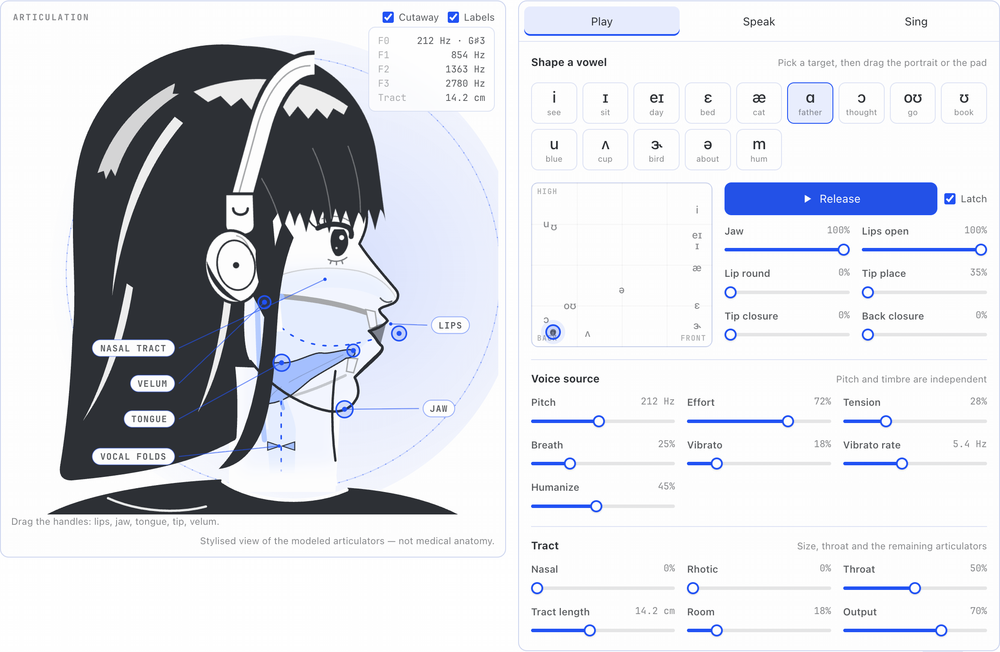
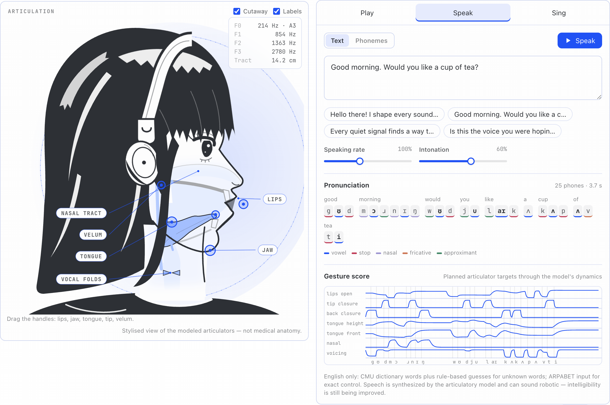
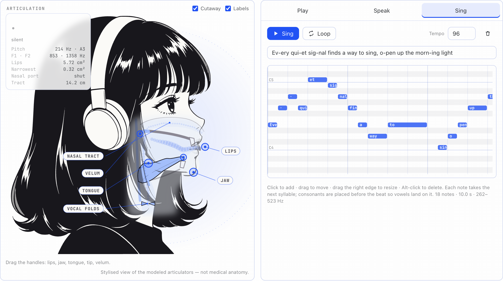
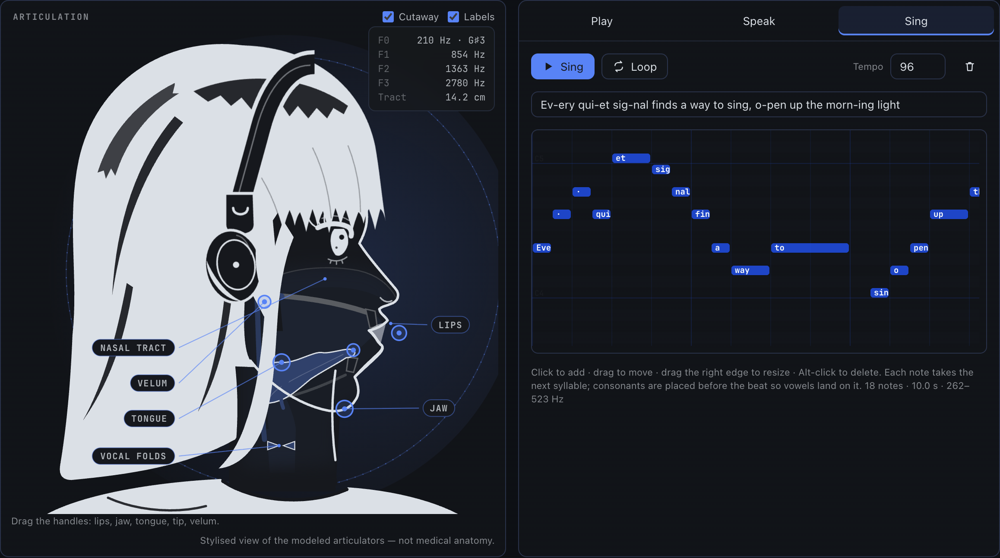
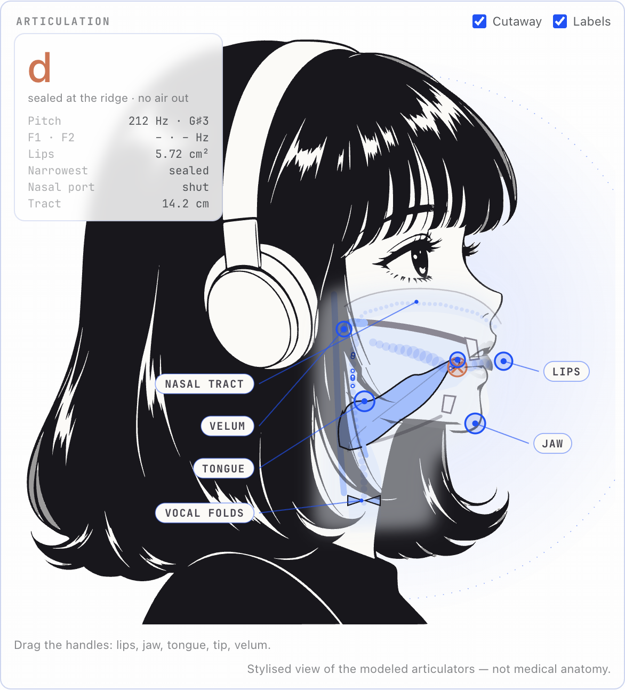
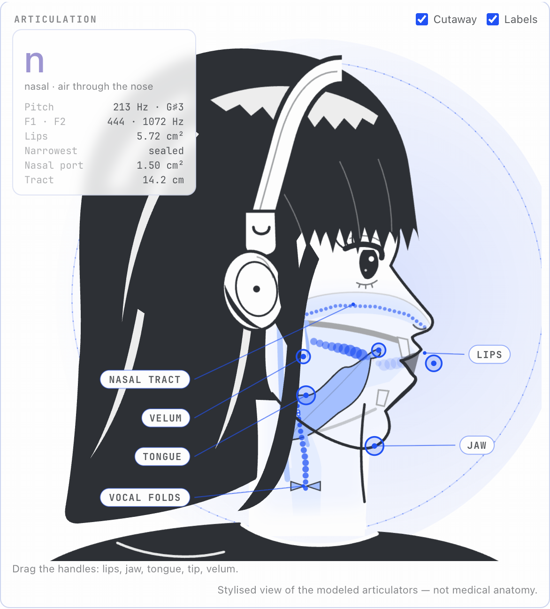
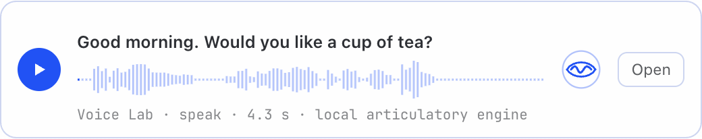

# Hermes Voice Lab

A vocal synthesizer for Hermes Desktop built on a physical model of the voice. A side-profile portrait of Nous Girl, with her headphones, is the instrument: drag her jaw, lips and tongue and the sound changes, because the drawing and the sound come from the same articulatory parameters. Hermes can play it too: ask for a breathier voice, a different vowel, a spoken line or a short song, and the controls move in front of you.



Everything is synthesized locally by a Rust engine compiled to WebAssembly: a glottal source drives a simulated vocal tract. There are no recordings, no neural or cloud TTS and no network calls. The default voice is an original adult feminine character voice, clear, warm and slightly breathy. It is a fictional voice for the character and not an official Nous voice.

**Demo:** [Voice Lab in Hermes Agent Desktop](docs/media/hermes-demo.mp4) (86 s, 1080p). It shows the whole Hermes window. You ask the agent for a silly song. The agent writes one and hands it to Voice Lab. She sings it live, with a band that plays her melody. Then the physics: seal the tongue and the sound stops; open the nose and she hums. Last, a dive through her mouth into the full act. The agent turn was recorded with a scripted stand-in model, so the reply text is fixed. The tool calls, the plugin and the engine are real. Sources and rebuild steps are in [`demo/`](demo/README.md).

**Watch:** [Boop Bop, Live!](docs/media/boop-bop-song.mp4) (41 s, 1080p). She does a short lounge set: patter ("Hello, hello! Is this thing on?"), scat, a verse about her own tongue, lips, nose and jaw with the inside view open, a brag ("No samples. No auto tune. Just physics!"), a beatbox break and a bow. Sound and picture come from one offline engine run, frame by frame, so the mouth, the inside view and the floating words are in exact sync with the audio.

**Listen** (rendered by the shipped engine, 48 kHz mono): [phrase, Signature voice](docs/media/speech-signature.wav) · [song with lyrics](docs/media/song-signature.wav) · [Warm voice](docs/media/speech-warm.wav) · [Airy voice](docs/media/speech-airy.wav) · [vowel glide /ɑ i u o æ ɝ/](docs/media/vowels.wav)

| Speak | Sing | Dark theme |
|---|---|---|
|  |  |  |

## What you can do

- **Play.** It is an instrument: grab the tongue, jaw or lips on the portrait, or touch the vowel pad, and she sounds while you hold, the shape changing under your finger. The pad morphs whole calibrated vowel shapes (jaw, lips and tongue together). While a note sounds, hold **Hum**, **Seal lips**, **Roll** or **Growl** to articulate over it, and slide **Body** from a child's tract through hers to an adult man's with the pitch held. Play notes from the on-screen or computer keyboard (A–; keys, Z/X for octaves) or a MIDI keyboard (the **MIDI** button asks for access). Pitch, effort, tension (glottal pulse shape), breath, vibrato and humanize are independent of the tract shape. Voice quality has four physical controls: **falsetto** (thin folds that never quite close), **fry** (paired, creaky pulses), **growl** (the ventricular folds flapping at half the pitch) and **twang** (a narrowed epilarynx that rings at 2.5–4 kHz). She can also make sounds without lung air: a glottal stop, ejectives (p' t' k', where the larynx is the piston) and clicks ("tsk", the kiss click ʘ and the pop ǃ, where the tongue pulls a vacuum). She can trill: "brr" is a lip trill and "rrr" a rolled r, with the phonemes RR, BR and RU (uvular) for direct input. Presets include Head voice, Gravel and Twang, plus Child, Tenor and Baritone bodies: tract length and pharynx proportion fitted to published vowel formants for children and men. The tract shape covers the jaw, lips, rounding, tongue tip and back, velum (nasal), rhotic bunching, throat width and tract length.
- **Speak.** Type a short English phrase, or phonemes in ARPABET or IPA (`həˈloʊ wɝld`, with ˈ ˌ for stress; the IPA set covers the trills, clicks, ejectives and ʔ too). The planner turns words into overlapping articulator gestures with stress, durations and intonation. A gesture score shows the planned trajectories, and the current phone is highlighted while it plays. A consonant chart (place × manner, including the trills, ejectives and clicks) lights the sound being spoken; click any consonant to hear it between two vowels.
- **Sing.** Write lyrics and draw notes on a piano roll. Each note takes the next syllable. Onset consonants are placed before the beat so vowels land on it, and a lone `-` holds the previous vowel across notes. Long notes get delayed vibrato. **Cartoon** style makes her sing like an animated character: pitch scoops into every note, slides on held syllables, fall-offs at phrase ends, wide wobbly vibrato and an oversized jaw and lips. **Duet** adds a second singer with their own body and voice (Baritone, Tenor, Child, …) on a part derived from the melody (an octave below, a fifth below, or a third above in the song's key) or written out by Hermes; each singer has their own engine. **Live** turns the keyboard (on screen, computer keys or a MIDI keyboard) into the singer: each key you press sings the next syllable of the lyrics at that pitch and holds the vowel until you let go; a legato key carries the last syllable's final consonants into the next. **Yodel** style sings the high notes in falsetto and the low ones in chest voice, snapping between them. **Silly song** loads an original scat demo that works each part of the mouth in turn. With **Stage** on, sung syllables pop out of her mouth and float away, music notes puff out on held notes, her head bobs on the beat and lifts on high notes, and a karaoke line follows the song.
- **Beat.** Beatbox pads that sound the moment they are pressed, and a 16-step sequencer. One mouth plays one sound per step: kick (an ejective p′, the larynx as the piston), snare (pf), closed and open hats (ts), a click (the tongue's vacuum), a lip-trill bass and a hum. Presets, tempo and loop; Hermes can write patterns too. Lyrics can also contain bracketed phonemes such as `[T+S]`, sung as written.
- **Bestiary.** Animal calls from physical sources. A songbird sings through a syrinx whose two sides can hold different notes, a short trachea and a beak that opens wider for higher notes. An elephant trumpets with lips buzzing into a two-metre trunk that loads the buzz like a brass instrument. A seal barks and an alligator bellows through the same kind of airway as ours, longer and growling. (A real bellow goes lower than this voice can.)
- **Watch it work.** Inside the cutaway, the airway lights up with the sound energy the engine computes in each section, and air particles drift from the vocal folds to the lips at the modeled airflow. Seal the airway with the tongue tip, the back of the tongue or the lips and the air stops at the seal, the sound in front of it dies, and the voice falls silent. Lower the velum and the air and sound leave through the nose instead. A readout names the sound being made (nearest vowel, or the sealed or turbulent place for consonants) next to lip, narrowest and nasal-port areas in cm². A top-down view of the vocal folds, slowed 100×, opens and closes with the modeled glottal pulse.
| Tongue tip sealed: the air stops at the seal | Velum lowered: air and sound leave through the nose |
  |---|---|
  |  |  |
- **See it.** The cutaway shows the modeled mouth, tongue, throat and nasal path. The airway panel draws the area function the engine is using, the spectrum overlays the measured output on the modeled tract resonances (F1–F4), and the waveform and glottal-pulse panels show the output and the LF pulse. Panels are labeled *measured* or *model*.
- **Record it.** A recording chain after the voice: microphone distance (close adds the proximity bass, far is thinner, duller and roomier), a three-band EQ, a compressor and drive. At neutral settings it is bypassed and the voice is untouched; the default voice uses a +3 dB lift at 1.6 kHz, fitted to real speakers.
- **Keep it.** Projects save with each conversation. Voice presets save per plugin. Projects can be saved to and opened from a folder you grant, and WAV export (48 kHz stereo) uses the same engine.

## Ask Hermes

The agent tools take structured instructions. The engine does all timing and synthesis.

| Tool | Does |
|---|---|
| `voice_lab_get` | Current voice, shape, phrase and song, plus parameter ranges, presets and vowels |
| `voice_lab_set_voice` | Change the voice (e.g. `{"breath": 0.6, "tenseness": 0.3}`), apply a preset, hold a vowel (`"vowel": "UW"`), optionally render a preview |
| `voice_lab_perform` | Speak a phrase, or sing a melody (`"melody": "E4:0.5 G4:0.5 A4:1 r:0.5 C5:2"`, `"lyrics": "o-pen the light"`) and return a WAV |
| `voice_lab_render` | Render the project, or a variation with temporary overrides, to WAV |

Calls are scoped to the active conversation, so edits appear in that conversation's Voice Lab, where a toast offers to play them. Renders come back as normal Hermes media. Desktop shows them in a Voice Lab audio card with the rendered waveform:



In Hermes builds with Tool Search, these plugin tools are discovered through `tool_search`/`tool_call` like other plugin tools.

**Read-aloud (optional).** The plugin registers a `voice-lab` TTS provider. Set `tts.provider: voice-lab` in a profile's `config.yaml` to hear replies in the character voice; voices are the presets (`signature`, `warm`, `bright`, `airy`, `lyric`, `alto`). It is English only and clearly less natural than neural TTS, so it is opt-in.

## Install

```bash
hermes plugins install Adolanium/hermes-voice-lab/plugin --enable
```

1. Run the command above. Hermes clones only the [`plugin/`](plugin/) folder (about 3 MB) into your profile's plugins folder and enables the agent side. The repository is private, so the machine needs Git access to it (for example `gh auth login`, or a Git credential helper that already works for `git clone`).
2. Restart the gateway so the plugin's routes mount.
3. In Hermes Desktop, open **Capabilities → Plugins**, enable **Voice Lab**, and open it from the sidebar or the command palette (**Open Voice Lab**).

Hermes warns that this is a custom source, not from the Hermes catalog. Update with `hermes plugins update hermes-voice-lab` and restart the gateway (until it restarts, it keeps the old backend, which refuses projects saved by the new UI), remove with `hermes plugins remove hermes-voice-lab`. Without Git access, copy the `plugin/` folder to `$HERMES_HOME/plugins/hermes-voice-lab/` by hand (or unpack the archive from `npm run package`) and run `hermes plugins enable hermes-voice-lab`.

You need neither Rust nor npm: `plugin/` ships the compiled WebAssembly engine, the desktop bundle and the Node renderer. Agent-side rendering uses Node 20+, which the Hermes runtime provides. Sound starts only after you press a play control.

## Build from source

```bash
npm ci
rustup target add wasm32-unknown-unknown    # Rust 1.98, pinned in rust-toolchain.toml
node scripts/build-engine.mjs              # engine → plugin/runtime/voice_lab_engine.wasm
npm run build                              # plugin/runtime/render.mjs + plugin/desktop/plugin.js
npm test && npm run test:engine && npm run typecheck   # BLESS=1 npm test re-blesses the golden renders after a deliberate sound change
npm run package                            # release/hermes-voice-lab-<ver>.tar.gz (optional)
HERMES_HOME=/path/to/test-home node scripts/install-dev.mjs   # copy plugin/ into a test profile
```

`node scripts/render-video.mjs --out show.mp4` renders a 1920×1080 performance video of the lounge set (`src/core/show.ts`) (needs ffmpeg and a Playwright Chromium; development tool, not shipped). `npm run dev` starts a standalone browser preview of the instrument. It is a development aid only and does not prove Hermes compatibility. `npm run calibrate` refits the vowel targets (see `docs/architecture.md`). Offline render example:

```bash
node plugin/runtime/render.mjs --text "Good morning." --voice warm --output /tmp/hello.wav
```

## How it works

The airway is simulated as a lossy acoustic transmission line in the time domain: 44 oral sections and a 30-section nasal branch carry the airflow from the lungs and the sound together. The glottis is an orifice whose area opens and closes, so the flow pulse, source–tract interaction and devoicing behind a closure follow from the physics. Turbulence noise is driven by the Reynolds number of the actual flow, at the constriction, at the teeth for sibilants and at the glottis. Bursts happen because air compresses behind a closure and escapes when it opens. Yielding walls, frequency-dependent wall losses, lossy nasal passages and lip and nostril radiation set the bandwidths. Tract length is continuous, set by the time step. Articulators move with critically damped dynamics, so live playback, the Desktop export and agent renders all follow the same sample-accurate score. On a 30-sentence Whisper test the speech went from 49% to 31% word errors with this engine and the planner fixes that came with it. Since then the voice has also been tuned toward real voices, one measured step at a time: speakers from the TSP speech database and a singer from the Children's Song Dataset (research use only; see `docs/validation.md`). Details: [docs/architecture.md](docs/architecture.md). Test coverage and host verification: [docs/validation.md](docs/validation.md).

## Limits

- English only. Pronunciation comes from the CMU dictionary plus fallback letter-to-sound rules; unknown words are flagged as guessed. ARPABET input gives exact control.
- Speech is intelligible but sounds robotic. On an automatic proxy (30 sentences transcribed by Whisper `small.en`), 31–35% of words come back wrong; on the ten easier sentences in `docs/validation.md`, about 10%. This is not a human listening test.
- The area-function geometry is a compact original parametric model, not measured anatomy. The cutaway is a stylized view of the modeled articulators.
- Not yet implemented: 3D views.
- MIDI input uses the Web MIDI API. Hermes Desktop's permission policy currently refuses it (the MIDI button says so), so it works only where the host grants MIDI access; it was not tested with a physical device. Beatbox sounds exist only as hits inside songs.

## Credits

The voice engine's approach and the demo act's format were inspired by Jameson Hodge's [chimera-vocal-synth](https://github.com/jamesondh/chimera-vocal-synth) (MIT). No code was copied; [NOTICE.md](NOTICE.md) says exactly what came from it. It also covers the dictionary license, character attribution and scientific sources.
