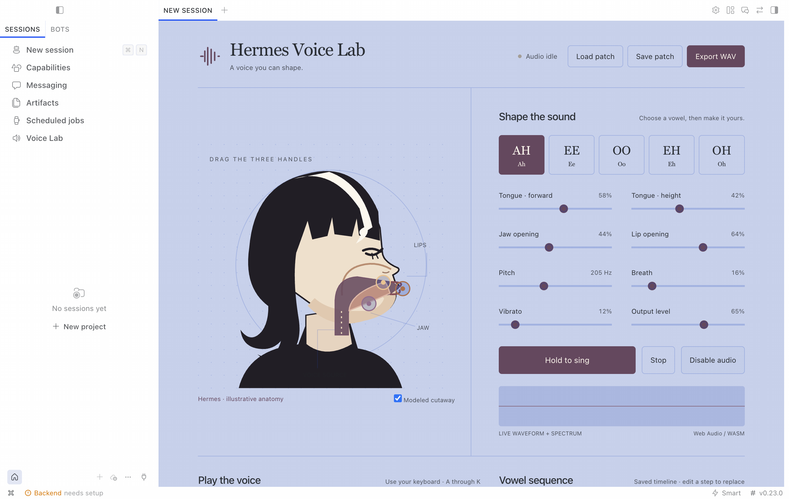

# Host validation

Validated on macOS arm64 against official Hermes revision `ee6db222660c84e4ba2cf158108f0e6fed9afe34` on 2026-11-08. The desktop was built from that checkout with its pinned Node 26 / pnpm 12 toolchain. All config, plugin copies, project state and Electron user data used disposable directories under the workspace's `research/` folder.

## Completed checks

- Official `hermes plugins validate` passed the compiled desktop plugin, manifest, isolated registration probe, declared tools, collision checks and public SDK lint.
- Installed Python plugin loaded through the real `PluginManager`. Registry dispatch changed pitch, refused out-of-range pitch and traversal IDs, and rendered a valid WAV through the shared Rust WASM engine.
- The render was 3 seconds, mono PCM16, 48 kHz, 288044 bytes, peak 0.14997 and RMS 0.03147.
- Native Electron discovered the packaged desktop half, enabled it, mounted the Voice Lab route and rendered the anatomy, parameters, keyboard, sequencer and text controls.
- Clicking Play sequence instantiated the embedded WASM AudioWorklet in the native renderer. AudioContext was running at 48 kHz with no page exceptions. The native analyser returned nonzero PCM, with a sampled RMS of 0.000205 during note onset and samples exceeding 0.001 absolute amplitude. Disable audio closed the contexts. Navigating away also closed them after asynchronous teardown.
- Editing the installed plugin file triggered live reload and closed all existing audio contexts. The route mounted again afterward.
- Native Save patch followed by Load patch restored the saved project successfully. The native file-save-dialog WAV flow was not tested; offline WAV output and authenticated download binding were checked separately.
- Native Save patch reached the backend and delivered `plugin.hermes-voice-lab.project.updated` through the actual gateway stream with matching session/project IDs. The UI applied the returned project. Registry tool execution was tested separately; no LLM turn was run.
- A global agent patch also updates matching timed-event overrides, so existing sequences hear the requested change.
- Persisted disabled state removed the route after reload; re-enabling restored it.

The native check initially resolved the machine's published Hermes backend executable at revision `2bd378ed1b8d6bf2192cb26e0a55ff3091e6bd19` while retaining the isolated HERMES_HOME. Agent integration checks use the pinned research checkout directly. The desktop reports that its backend needs a model provider; local synthesis and offline tools do not require one. No live user configuration was edited, and no model calls were made.

## Reproduce

Build the plugin with `npm run build`, copy the package into an isolated `$HERMES_HOME/plugins/hermes-voice-lab`, and enable its agent half in that test home's `config.yaml`:

```yaml
plugins:
  enabled:
    - hermes-voice-lab
```

Run `hermes plugins validate /absolute/path/to/hermes-voice-lab` using the official Hermes runtime. Enable the desktop half in Capabilities → Plugins. For an isolated development app, set both `HERMES_HOME` and `HERMES_DESKTOP_USER_DATA_DIR`; also set `HERMES_DESKTOP_HERMES_ROOT` to pin the backend checkout rather than allowing launcher discovery. Play a note, disable audio, navigate away during playback, and rescan after changing the plugin file.

Tool calls need an explicit durable conversation ID and project ID. `voice_lab_patch` accepts `patch` and an optional full `project`. `voice_lab_render` renders the saved project and returns a standalone `MEDIA:` attachment line. In an active tool turn, a different conversation ID is refused.

Do not distribute compiler target caches, node_modules, research checkouts, test profiles or generated environment scripts. The package script includes only runtime files and documentation.

Native screenshot: 
