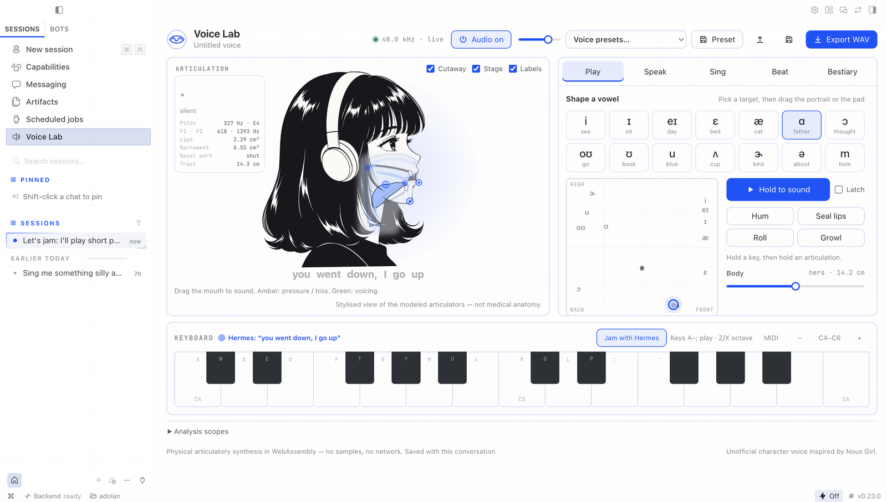

# Hermes Voice Lab (plugin)

A singing, talking voice you can play inside Hermes, made by a physical model: a simulated glottis, throat, tongue, lips and nose, with air pushed through them in real time. No samples, no recordings, no neural or cloud TTS. The portrait is the instrument: drag her tongue, jaw and lips, play notes on the keys, sing lyrics live, beatbox on pads.

The agent can play her too. It speaks lines, writes songs and beats, changes her voice, and **jams with you**: press **Jam with Hermes**, play a phrase and pause, and the agent sings an answer.



## Install

```bash
hermes plugins install hermes-voice-lab --enable
```

Restart the gateway, then enable **Voice Lab** in Hermes Desktop under **Capabilities → Plugins**. It needs Node.js on the gateway machine for the agent's WAV renders (the Desktop instrument runs without it).

## Agent tools

| Tool | Does |
|---|---|
| `voice_lab_get` | Current voice, shape, phrase and song, plus parameter ranges, presets and vowels |
| `voice_lab_set_voice` | Change the voice, apply a preset or hold a vowel; optional preview WAV |
| `voice_lab_perform` | Speak a phrase, sing a melody with lyrics, or beatbox a 16/32-step pattern; returns a WAV |
| `voice_lab_render` | Render the project, or a variation, to WAV |
| `voice_lab_jam` | Sing an answer to the phrase the user just played (nothing is saved) |

An optional read-aloud provider (`tts.provider: voice-lab`) speaks replies in the character voice. It is off unless you set it.

## What it does on your machine

- **No network calls.** Synthesis is local: WebAssembly in the Desktop window, and the same engine under Node for the agent's renders.
- **One subprocess.** Agent renders run `node runtime/render.mjs` with a fixed argument list (no shell) and a 90 s timeout.
- **Files.** Projects and WAVs are written only under the plugin's data folder (`plugin-data/hermes-voice-lab/sessions/<id>/`). Project files you save or open go through the Desktop's folder grant.
- **Chat turns on your behalf, only in Jam.** With **Jam with Hermes** switched on, each phrase you play is sent to the focused conversation as your message (`🎹 Jam · I played … Your turn.`), and the agent answers. Nothing is sent while Jam is off.
- **Microphone, no. MIDI, opt-in.** The **MIDI** button asks the browser for MIDI access; nothing else asks for device access.

## Build provenance

`runtime/voice_lab_engine.wasm` and `desktop/plugin.js` (which inlines the same engine and the CMU-derived lexicon, because the Desktop loader takes one file) are build outputs of this repository's sources: the Rust engine in `engine/` and the TypeScript in `src/`. The repository's GitHub Actions workflow rebuilds both from source on every push to `main`, fails if they differ from the committed files, and attaches a GitHub build-provenance attestation to each:

```bash
gh attestation verify runtime/voice_lab_engine.wasm --repo Adolanium/hermes-voice-lab
```

Source, documentation, tests and credits are in the [repository](https://github.com/Adolanium/hermes-voice-lab). The engine's approach was inspired by Jameson Hodge's [chimera-vocal-synth](https://github.com/jamesondh/chimera-vocal-synth); see `NOTICE.md`.
